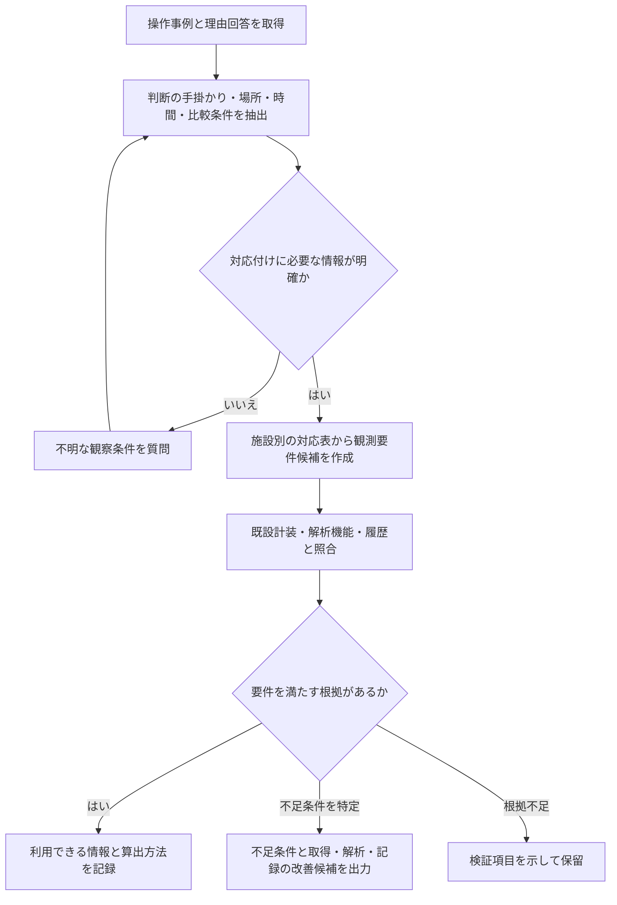

# 第73回：PAC注入の判断理由を観測要件へ変換する内部構造

調査日：2026-10-13。ユーザーは具体検討対象として「浄水：PACなど凝集剤の注入」を選択。以下は設計提案であり、実施設で検証された仕様・特許性確定済みの発明ではない。既設計装・実際の操作理由は未取得。

## 中心とする問い

運転員が判断に使う情報を対話で取得し、その情報を現在の監視で得られるかを整理する。単にセンサ名を推薦するのではなく、「その人が区別した状態を、どの観測条件で区別できるか」を扱う。

「観測値を取得可能」「その値から状態判別可能」「その状態に対する制御が適切」の3段階は別。今回は主に最初の2段階を設計し、制御の自動実行を前提にしない。制御理論上の厳密な可観測性を証明するモデルではない。

## 確認した浄水技術の背景

- [鈴木ほか、2022、計測自動制御学会論文集](https://www.jstage.jst.go.jp/article/sicetr/58/5/58_271/_article/-char/ja/)：ジャーテスト中のフロック画像からDCNNで凝集後濁度を予測。公開抄録は開始200秒後の画像が当該実験で適したことを報告。一般施設の最適観測時刻を200秒とする根拠ではない。今回は抄録確認、本文全体未精査。
- [有村ほか、2023年巻、2024-03-15公開](https://www.jstage.jst.go.jp/article/jscejj/79/25/79_23-25019/_article/-char/ja/)：顕微鏡電気泳動を用いる画像処理型凝集センサ、荷電状態の指標を使ったフィードバックと極値探索による目標調整をラボ評価。単純な外観撮影と荷電状態計測を同一視しない。抄録確認。
- [機械学習を活かした凝集制御および原水濁度予測システムの開発、2026](https://www.jstage.jst.go.jp/article/jwwa/95/1/95_17/_article/-char/ja/)：注入率予測と凝集状態良否判定の組合せを実浄水場で長期検証、流域気象による原水濁度予測も報告。抄録確認。
- [1988年フロック形状評価](https://www.jstage.jst.go.jp/article/kakoronbunshu1975/14/3/14_3_395/_article/-char/ja/)：回分槽の撮影画像に基づくフラクタル形状定量化。画像で大きさ・形を定量化すること自体は新しい発想ではない。

検索で見つけた厚労省通知ページは関連PDFへの入口で、今回HTMLからジャーテストの該当段落を再確認できなかったため、現行の運転基準を断定する根拠として用いない。ここでの具体例は操作推奨値や注入量増減の正解を示すものではない。

## 仮例と対話設計

操作：運転員がPAC注入率を変更。

理由回答例：「濁度は変わらないが、フロックがいつもより細かかった」。これは仮例であり、PAC増量が適切だったと仮定しない。

この文だけから「粒径を測れば判断を再現できる」と確定しない。「細かい」が意味する手掛かりには粒径、微小フロックの割合、成長の遅さ等があり得る。また観察が実池かジャーテストかも不明。

質問候補は以下。毎回全部聞く仕様ではなく、理由から既に分かる事項と監視台帳から分かる事項を除き、対応付けに必要な不明点だけを確認する。

1. 観察場所：「実際のフロック形成池ですか、それともジャーテストですか」。
2. 手掛かり：「粒の大きさですか、できるまでの時間ですか、それ以外ですか」。誘導を避け、自由回答を許す。
3. 比較対象：「『いつも』は直前の状態ですか、同じ原水条件の過去の状態ですか」。
4. 観察条件：必要なら観察時点・試験工程・経過時間を確認する。実池の水理滞留・移送遅れは実施設データに基づく別の対応付け。

最初の実装では人が確認した手掛かりを保存し、LLMが挙げただけの候補は確定情報と分ける。厳密な数値閾値を運転員が知らない場合は未設定のままにし、仮の基準で埋めない。

## 内部表現案

文章を直接センサ名へ結ぶのでなく、次の中間表現を作る。

| 項目 | 仮例 | 役割 |
|---|---|---|
| 操作事例 | 設備・系列・操作時刻・注入率変更 | 理由と実操作の関連付け |
| 判断対象 | フロック形成状態 | 状態と測定量を区別 |
| 手掛かり | 粒径が比較状態より小さい | 観測対象の候補 |
| 観察対象 | 形成池の指定地点、又は試験槽 | 既設計測との場所対応 |
| 時間条件 | 観察時刻、試験開始からの経過等 | 違う工程・時点との誤照合を防ぐ |
| 比較条件 | 直前、同条件の過去、ジャーテスト別試料等 | 「いつもより」を計算できるか |
| 根拠状態 | 発言・回答で確認／文献からの候補／未確認 | 推測の確定扱いを防ぐ |

状態から測定量への変換には、施設別に承認した対応表を使う。例えば粒径分布は画像からの候補となるが、画像の光学条件・対象範囲・解析機能が適合するかを別に確認する。フロック外観と沈降性を自動的に同義としない。代理指標は適用条件と検証結果を持つ別の対応として扱う。

## 監視情報との照合

各計測点の「項目名」だけでなく、対象設備・地点、取得時間・更新周期、測定範囲・精度、画像なら空間分解能・視野・照明、利用できる解析機能、履歴と比較基準を持つ。仕様不明は不適合ではなく未確認とする。

照合結果の例：

- 粒径分布が必要だが原水濁度しかない：対応する判断材料の取得不足。ただし濁度が無意味ということではない。
- カメラが存在するが、池全体の遠景しか映らない：対象の粒を区別できる撮影条件か確認。名称一致だけでは充足としない。
- 指定地点の画像はあるが過去の比較画像が残っていない：「いつもより」という判断の比較情報が不足。
- 画像も履歴もあるが手掛かりを計算する解析がない：センサ追加でなく処理機能追加の候補。
- 試験槽の観察を実池画像で代用したい：試験条件と実池条件の差を確認。未検証なら代用可能と断定しない。

ここでの「粒径が小さい」単独でPAC不足や操作の正解を断定しない。取得不足、推定モデルの不足、制御判断の不足を分離する。

## 出力案

「カメラを追加」ではなく、理由中の手掛かりに対応する不足条件を出力する。

例：対象は○系列フロック形成池の指定観察地点。取得したい情報は粒径分布と比較基準。現在は遠景映像のみで粒径計測能力は未確認。候補は既設画像の分解能・照明確認、適合しなければ観察画像取得条件の追加。比較履歴の保存も必要。根拠は当該操作に対する運転員の確認済み回答。実際の分解能・周期・必要精度は検証待ち。

結果区分：既存情報で対応可能／既存情報の解析・連携・記録追加で対応候補／観測手段追加の候補／情報不足で判定保留。

## 処理の流れ

無回答・曖昧なままなら質問ループを打ち切って保留。人に繰り返し説明を強いる仕様にしない。

## 技術的効果の仮説と検証

効果仮説：既設データで足りる判断をセンサ不足と誤判定しない。逆にセンサ名が一致するだけで判断材料が揃ったと誤判定しない。不足の種類を特定し、不要な機器追加を避けられる。未測定。

まず過去の操作理由10～20件程度を試行用に整理し、運転員と計装担当者が判断材料・既設での取得可否・不足条件を確認する。件数は初期検討の提案で、性能証明に十分という意味ではない。LLM直接センサ推薦、項目名のみ照合、本方式を比較し、誤った充足判定・誤った追加提案・保留率・質問負担を測る。

次に、収集した観測が確認済み手掛かりを判別できるかを別日に評価する。運転員の判断一致と、処理水質等に照らした運転妥当性は別の指標。既存監視が似ていて人の判断が違う事例は未観測候補を見つける入口にはなるが、人の誤判断・目的差・計器故障等もあり、それだけで未観測原因を証明しない。

## 追加先行技術：請求項と注意点

| 文献 | 確認した請求項・内容 | 今回との関係 |
|---|---|---|
| [US10031973B2](https://patents.google.com/patent/US10031973B2/en)、登録2018-07-24 | 登録1はセンサデータ・メタ情報、意味／時間／場所の情報、オントロジー、検索の分解、対応情報抽出、検索頻度等による順位付けでセンサ特定。2は測定範囲等、3は計測能力・時刻・場所、6は時間／場所等の検索成分。親項を継承。 | センサ能力・時刻・場所との意味的照合だけを新規と扱えない。理由対話から比較を含む判断材料を獲得する前段と差分出力の結合が未確認。 |
| [JP5536204B2](https://patents.google.com/patent/JP5536204B2/ja)、登録2014-07-02。同族[EP2446364B1](https://patents.google.com/patent/EP2446364B1/en) | 日本登録1は形式的オントロジーと既定センサ能力で問合せ分類、コード断片から実行問合せ・プログラム生成、センサノードで実行・結果取得。9・10は問合せ確認。EP登録1・10も確認。日本の本文付記と登録請求項を区別。 | センサ能力に応じて問いを処理する構成は先行。人の判断理由を聞いて未取得要件を作る構成とは異なる。 |
| [JP2024007610A](https://patents.google.com/patent/JP2024007610A/ja)、公開2024-01-19 | 公開1は照明・カメラ・備品と被写界深度又は照射範囲を狭める撮影。11は画像から大きさ取得、12は粒径分布・平均、13はそれに基づく注入率決定。いずれも親項の光学構成を継承。 | フロックの撮影・粒径・注入率決定は既存。単に画像を追加してPAC制御する案を中心にしない。登録版未確認。 |
| [JP7032485B2](https://patents.google.com/patent/JP7032485B2/ja)、登録2022-03-08 | 登録1は実原水等の回分／連続試験で画像と運転良否のデータを取得し、MLモデル構築、実運転前に導入。2は実運転データ追加、3は実設備で測定可能な説明変数、4はフロック画像。 | 試験・画像・実運転の学習と制御は先行。理由から観測要件を作る構成とは区別。 |
| [JP6173808B2](https://patents.google.com/patent/JP6173808B2/ja)、登録2017-08-02。公開JP2015016415A | 登録1・2はジャーテストの濁度・吸引ろ過時間比STR、ろ過池現在水位・水位上昇速度・洗浄までの時間等から許容STRを設定、表示して注入率設定。6は実沈殿滞留と試験静置時間差による補正。公開より登録項は具体的。 | 複数工程・時間条件を考慮する浄水制御も先行。場所・時間を足すだけで特許性があるとは言えない。 |

既出JP2005100026A公開7・8は監視不能要因と適した監視項目抽出、JP7780591B1登録1等は対話から監視設定案生成。今回案の全体の新規性・進歩性は未判定。公式現況・包袋未確認。

## 発明の中心候補

操作理由から「判断対象と比較対象との違いを示す観察手掛かり」を取得し、当該手掛かりを判別するための観測要件を構成し、既存の計測・解析・履歴が満たさない条件を特定して、その条件に対応する情報取得要件を出力する。

「比較対象」は毎回必須とは限らず、絶対閾値や有無による判断もある。比較型理由を具体的実施形態として検討する。対話で必要条件を取得→同じ条件を監視照合に使用→不充足条件を改善出力に使用、という依存関係を具体化する。これ自体の先行調査は未完で、特許性の裏付け済みとは扱わない。

次に必要なのは実施設のPAC変更理由、プロセス系統と計測点、画像取得条件、ジャーテストの記録形式、時系列データ保存条件。実データがない段階では架空の仕様値を決めず、上記を仮設計として維持する。
