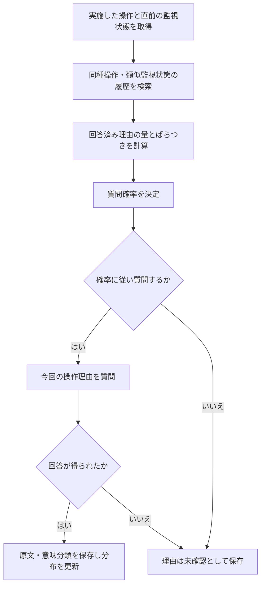

# 第77回：操作理由の分布を使う確率的な質問選択

調査・具体化：2026-10-13。ユーザーが質問確率を下げる方式を提案し、その入力・計算規則を具体化して公知例と比較する方針を承認。以下は検討用の一方式で、採用確定・登録可能性確認済みではない。

## 1. 前回からの修正

第75・76回の「監視情報で評価できる条件は必ず質問対象から外す」を固定仕様としない。質問しなかった操作理由は未確認とし、監視値から確定した理由を自動記録しない。理由の誤帰属が必然という第76回の懸念は撤回。質問選別の進歩性は別に検討する。

## 2. 固定する方式

同種の実操作について、現在と似た監視状態の過去事例を検索し、回答済みの理由が一貫していれば質問確率を下げる。一方、似た監視状態でも回答理由が異なる場合は質問確率を高く維持する。履歴がない状態では質問確率を高くする。目的は実操作理由の効率的収集であり、操作の自動実行や正当性判定ではない。

### 保存情報

操作ID、設備、操作種別・変更方向、操作直前の監視状態と取得時刻・品質、理由の原文、理由の意味分類（複数理由は組合せとして保持）、質問実施確率、質問有無、回答有無。未質問・無回答の事例も操作と状態は保存するが、理由分布の回答件数へ加えない。

LLMは理由の意味分類を補助する。単なる言い換えを別理由に数えず、複数理由を一つに潰さない。原文と対応を保存し、意味分類の誤りは訂正可能にする。LLM自身の確信度を質問確率として使わない。

### 監視状態の比較

同じ設備又は予め定義した比較可能設備、同種操作・変更方向、所定の履歴期間で候補を絞る。PAC例は原水濁度、濁度の直近変化、水温、流量、変更前の注入設定等。項目・単位・比較期間・尺度は施設ごとに設定する。過去理由から比較項目を追加する場合は施設タグと照合し、比較仕様の版を管理する。現在まだ取得していない理由を検索入力にしない。操作後の結果を操作直前の状態に混ぜない。

正規化距離dにより、dが閾値以下ならw=exp(-d²/2)、それ以外w=0とする作業案。必要な監視項目が欠損・期限切れなら「状態が似ている」と扱わず、データ不足として扱う。これは施設仕様・実データで調整すべき方式例で、距離関数の新規性を主張しない。

### 計算規則の一例

現在の操作と状態に対し、理由回答のある各過去事例の類似重みw_iを用いる。

- N=Σw_i：類似事例について取得済みの理由の量。統計的な有効標本数ではなく重み付き件数。
- q_k=Σ(w_i・理由分類kに該当)/N：理由分類の重み付き頻度。
- H=-Σq_k log(q_k)/log(K)：理由のばらつき。Kは比較時に固定する理由分類数。N=0又はK<2ならH=0とする。
- p=ε+(p_max-ε) min{1, 1/(N+1)+[N/(N+N0)]H}。

εは最低質問率、p_maxは最高質問率、N0は少数回答のばらつきを過大視しないための係数。新しい分類はその他を含め分類体系を更新し履歴を再集計する。分類数を変えた前後のHを無条件に比較しない。

一様乱数u<pなら理由を質問し、回答が得られた場合だけ理由分布を更新する。初回N=0ではp=p_max。Nが多くHが小さい状態ではpが下がる。一つの理由の1件だけで確信した扱いにしない。この式は説明可能な試作仕様であり、統計的最適性・特許性・実施設での効果は未検証。

### 数値の挙動確認（実験結果ではない）

ε=0.05、p_max=0.80、N0=5、事例重みが全て1、理由分類が2種の仮定で計算。

| 履歴 | N | H | 質問確率 |
|---|---:|---:|---:|
| 初回 | 0 | 0 | 80.0% |
| 1件のみ | 1 | 0 | 42.5% |
| 20件が同じ理由 | 20 | 0 | 8.6% |
| 20件で二つの理由が半数ずつ | 20 | 1 | 68.6% |

数値はJavaScriptで確認。施設向け推奨値ではない。全操作に一律の回数減衰を適用する方式とは、同じ件数でも理由分布により質問率が異なる。

### フロー

## 3. 公知例の追加確認

### 確率的に質問すること自体

[Agnostic Active Learning Without Constraints](https://arxiv.org/html/1006.2588)、初版2010-06-14、NIPS 2010。[会議版](https://papers.nips.cc/paper_files/paper/2010/hash/00411460f7c92d2124a67ea0f4cb5f85-Abstract.html)。本文2.2・2.3・Algorithm 1を確認。現在入力と過去の質問済みラベルに応じて質問確率を決定し、確率に従ってラベルを取得、逆確率重みを扱う。今回の確率化・最低限の質問維持・取得確率記録を独自とは扱わない。対象は分類ラベルであり、実施済み操作理由の分布を同じ操作・類似監視状態に条件付ける構成は今回確認箇所にない。

[Importance Weighted Active Learning](https://icml.cc/Conferences/2009/papers/392.pdf)、ICML 2009は公式検索本文・要旨確認。全文の今回精査はしていない。選択バイアス補正の先行として記録。

### 理由情報を使って質問を選ぶこと

[Active Learning++](https://arxiv.org/html/2009.04568)、2020-09-06公開、本文2・3を確認。人が重要特徴を順位付けし、モデルの説明との一致により委員会モデルを重み付け、質問対象を選ぶ。今回は実回答理由同士の条件付き分布であり、モデルと人の特徴順位の一致やモデル委員会は必須にしない。

[XAL](https://arxiv.org/html/2310.05502)、初版2023-10-09、今回本文v4（2024-12-15）の3.3を確認。分類の予測エントロピーと生成説明のスコアでラベル取得対象を選ぶ。理由・説明を質問選択に使う一般構成は既存。今回は生成説明の良さではなく、実際に得た運転理由の分布を使う点が相違。

[US20220237504A1](https://patents.google.com/patent/US20220237504A1/en)、公開2022-07-28、IBM、Optimizing a machine learning system。公開1・2・7・9・11、本文FIG.2関連を確認：人の特徴順位と各分類器の順位の比較、類似度による重み付け、モデル間不一致から次の教示例を選択し再学習。産業機器の例もあるので単なる産業用途で差を主張しない。

同族[US12182671B2](https://patents.justia.com/patent/12182671)、2024-12-31登録。Google登録ページは取得失敗、登録請求項はJustia転載で1・2・6・8・10を確認。登録1は特徴寄与の重要性・正負方向の情報、モデル間予測と確信度の不一致も含む。登録6は最大不一致事例と人の新ラベルから追加学習。公開7と登録6を混同しない。公式登録原本・日本同族・包袋は未照合。公開本文と非特許文献で公知性を判断し、転載のみで権利範囲・現況を確定しない。

### 質問負担との調整

[To Ask or Not To Ask: Human-in-the-loop Contextual Bandits with Applications in Robot-Assisted Feeding](https://arxiv.org/html/2405.06908v2)、初版2024-05-11、今回v2本文V・Algorithm 1を確認。候補動作の性能不確実性と予測質問負担を比較して聞くか決める。質問率を回数で指数減衰させる比較方式もある。操作を支援する前の援助要求であり、実施済み操作理由の収集とは異なる。ただし質問負担とのバランス自体は既存。

### 日本の不確実性・教示対象選別

[JP7395396B2](https://patents.google.com/patent/JP7395396B2/ja)、公開JP2021149818A（2021-09-27）、登録2023-12-11。登録1は入力を部分分割し、部分ごとの不確実度を、検証状態で選んだ方法により統合。登録3は親項を継承し、高不確実性のデータで学習。本文は能動学習・エントロピー・委員会不一致を既存手法として説明。本案は入力部分分割とその不確実度統合を必須にしない。能動学習全体をこの登録特許が独占するとの解釈はしない。

### 検索候補・未精査

NAACL 2015 [Active Learning with Rationales for Text Classification](https://aclanthology.org/N15-1047/)は書誌と公式検索でAlgorithm 1の理由取得概要を確認、今回PDF全文精査未了。2025 [Why does this query need to be labeled?](https://www.sciencedirect.com/science/article/pii/S0957417425020627)は要旨・公開された節抜粋：取得スコアの特徴寄与を説明して人が重みを調整。本案と同一と断定しない。Adaptive Experience Sampling（2010頃）は検索抜粋のみでセンサ状態・イベントによる質問時点と質問内容の適応を確認、正式書誌・原文精査保留。

JP4645288B2、US8794971B2、US20250032019A1、US20260289426A1、US4860214A、LtA（arXiv:2510.08314）、Entropy Guided Diversification（arXiv:2603.11399）は今回検索候補。請求項又は本文の精査未了で、結論を支える主引用には使っていない。

## 4. 特許性の評価

新規性：今回追加調査では、実施済み操作＋操作直前の監視状態＋実回答理由の条件付き分布＋取得量による質問確率制御という一連に一致する単一文献は未特定。ただし全分類・引用追跡は未了で、新規性確定ではない。第75回の5要素とは構成が変わっているため同回の結論をそのまま転用しない。

進歩性：単に理由をラベルとする能動学習への置換で得られる可能性がある。既存の操作理由記録JP2020173683Aに、確率的な教示取得・不確実性評価を組合せる拒絶論理を具体的に想定できる。理由を収集するという目的変更、類似事例検索やエントロピー、式の係数だけで進歩性を主張しない。

比較上の差分候補は、操作が同じで監視状態も似ている場合の実回答理由の多様性を評価し、操作自体は予測できても理由を追加取得する点。この用途上の差が通常のラベル選択で尽くされるか、操作理由と監視項目の具体的な結び付きに独自の処理があるかは未立証。現時点で出願推奨へ変更しない。確率計算の具体化は完了し、特許性の肯定は未成立。

仮請求項骨子：実施済み制御操作及び直前監視状態を取得する取得部、同種操作かつ類似監視状態の理由回答済み履歴を抽出する検索部、履歴の理由分類分布と回答取得量から理由取得質問の実施確率を決定する対話制御部、確率に応じて質問を提示し回答と操作を関連保存する記録部。式・係数は必須限定の案ではない。未質問理由を推定で埋めないのはデータ取扱方針で、それだけを新規性の核としない。

## 5. 技術的な限界・検証

- 似た状態の異なる理由は、未監視要因、操作者差、複合理由、意味分類誤りでも生じる。センサ不足や操作間違いと断定しない。
- Hが大きいことは、必ずしも次の1回答の学習価値が高いことを意味しない。継続する多様性と知識不足を同一視しない。高い質問率を維持するのは理由記録の方針であり、最適な学習効率の保証ではない。運用では質問上限又は利用者設定を別途決める。
- 適応的な質問で集めた履歴は母集団頻度と一致しない場合がある。pを記録し、実証時に逆確率重み等を検討。無回答偏りは質問確率の補正だけでは解消しない。上式の頻度はまず取得済み回答内の分布と定義し、母集団推定と宣言しない。
- 比較：毎回質問、一律低確率、操作ごとの回数減衰、通常の理由予測エントロピー、本案。指標：質問件数、新しい理由の取得数、後日の無作為確認で見つかる未取得理由、分類訂正負担。現時点で実施設データ・実測効果なし。

引継ぎ：初期設計と追加公知例調査を完了。権利化肯定のためには通常の理由分類の能動学習と具体処理が異なるかを追う。単に数式を作ったから進歩性が強まったとは説明しない。
