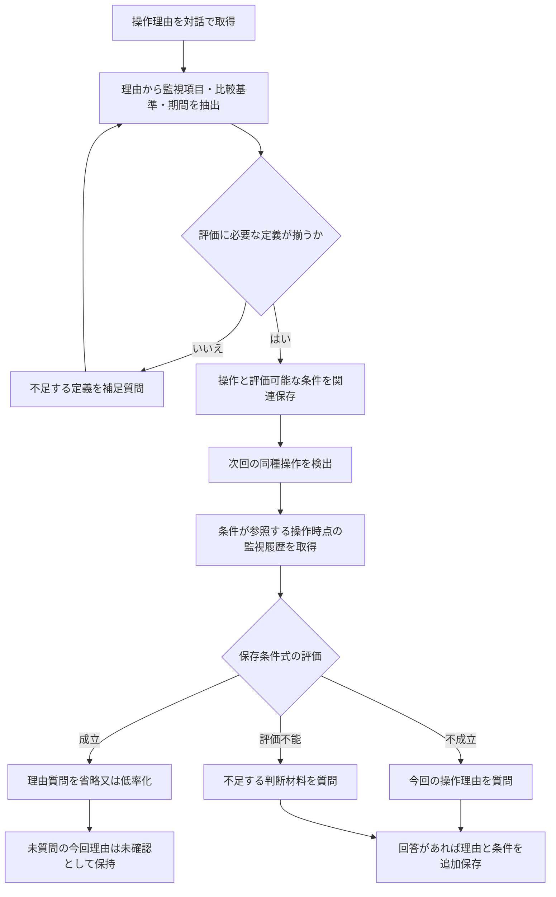

# 第78回：操作理由に由来する監視条件で次回の質問を制御する方式

検討日：2026-10-13。日本中心・海外参考。第77回の全監視状態の類似度・理由分布から、ユーザーの指摘により「理由が比較項目と比較粒度を決める」方式へ変更。具体化と追加公知例調査を実施。登録可能性確認済みではない。

## 結論

方式として実装可能な構造にできる。「状況が同じ」は、理由から定義した判断条件が、次の同種操作時点でも成立することと定義する。監視状態全体の距離や全数値の一致を求めない。

今回の追加調査で、理由を規則へ変換するASK、曖昧な条件・値取得方法を対話で定義するPUMICE、監視システムが根拠不足を質問するJP2025026446Aが重要比較対象になった。全体一致の単一文献は未特定だが、条件化・質問省略の具体化だけで進歩性が確立したとは言えない。

## 1. 固定する構成と目的

実施済みの制御操作について理由を取得し、理由中の判断条件を監視項目、比較基準、時間条件へ変換する。条件を操作と関連付けて保存し、次回同種操作が実施された際、その操作時点の監視情報で条件を評価する。保存条件が成立するとき理由取得質問を省略又は低確率化し、成立しない／評価不能のとき質問する。

目的は操作理由の知識獲得に伴う反復質問の軽減。保存条件の成立は、今回の本人理由の確定でも、制御の正当性確認でもない。未質問の理由は未確認のままとする。「同じ理由だった」と自動記録しない。

第77回の全状態類似度による近傍選択、理由分布エントロピーは必須にしない。確率方式を残す場合も、条件成立が質問確率を下げる入力となり、分布が必須という案ではない。

## 2. PAC操作の具体例

運転員の回答例：「原水濁度が普段より高く、さらに上昇していたからPAC注入量を増やした」。これだけでは比較基準・期間が曖昧であり、評価可能な条件として完成していない。

| 抽出する情報 | 対応する情報 |
|---|---|
| 対象操作 | 指定系列のPAC注入設定を増加した操作 |
| 判断に使った項目 | 指定系列の原水濁度タグ |
| 高さの条件 | 原水濁度 > 基準値B |
| 上昇の条件 | 操作時点を終端とする期間Wでの濁度増加量 > 増加基準D |
| 結合 | 二条件のAND。理由の「又は」「ただし」等を勝手にANDへ変えない |
| 原文との対応 | 各条件に対応する理由の箇所を保存 |

B、W、Dは説明のための記号で実施設の設定値ではない。閾値が元理由にない場合、過去の一つの測定値から閾値を逆算しない。比較定義は本人への確認又は本人が参照した施設の基準・設定の特定から得る。LLMの一般知識から補わない。「普段」は固定閾値か平常期間の集計かを区別する。

不足定義だけを初回の補足対話で取得する。例：「高いと判断した基準は何ですか」「どの期間の上昇を見ましたか」。判断基準を数値化できない場合は未定義として残し、次回の質問省略根拠に使わない。毎回すべてを質問する仕様にはしない。

## 3. 保存形式と実行処理

保存する条件：操作種別・設備又は適用範囲、判断材料、監視タグとの対応、比較演算、基準の出所、時間窓・集計式、論理結合、原理由・確認済み定義との対応。用途に応じて単位・欠測・データ品質・版も保持。項目を追加した数自体を新規性の根拠にしない。

次回処理：

1. 操作記録から対象設備、操作種別・変更方向、操作時刻t0を取得。
2. 対応する保存条件を取得し、参照する監視タグと履歴区間を決定。
3. t0及びt0以前の必要区間の監視履歴を取得。質問処理が遅れても、処理時点の最新値で代用しない。
4. 各条件を成立T、不成立F、評価不能Uに評価し、保存した論理式を計算。
5. 条件式がTなら理由質問を省略する。Fなら過去理由の条件では説明できない操作として今回理由を質問。Uなら不足している観察・定義を尋ねる。
6. 回答が得られれば新たな理由と条件を保存。無回答・未質問なら今回理由は未確認とする。

Uは、値がない、対象タグが未対応、品質不足、比較期間不足、意味定義が未完成等。FをUと同一視しない。条件がANDの場合、いずれかがFなら全体F、全てTならT、他はU。ORの場合、いずれかがTならT、全てFならF、他はU。

複数の過去理由を持つ場合は、各理由を別条件式として評価する。「少なくとも一つが完全にTなら省略」を作業上の選択肢とする。どれが本人の今回理由かは選ばない。この方針は既知の状況で質問を減らす一方、同状況で新たに生じる理由を取り逃す。取得漏れをどこまで許容するかに応じて、成立時にも低率の質問を残す選択肢がある。厳密な理由全件記録が必要な用途には省略方針は適さない。

### 分岐の確認例

| 条件1：高い | 条件2：上昇 | AND全体 | 処理 |
|---|---|---|---|
| T | T | T | 省略又は低率質問 |
| T | F | F | 今回理由を質問 |
| T | U | U | 未取得の比較情報等を質問 |
| F | U | F | 今回理由を質問。未知項目を埋めてもこのAND理由は成立しない |
| U | U | U | 不足情報を質問 |

これは論理の机上確認であり、施設実測による効果検証ではない。

## 4. 先行技術の追加確認

### JP2025026446A：監視システムで不足する根拠を質問する直接近接例

[日本公開](https://patents.google.com/patent/JP2025026446A/ja)、2025-02-21。Hamilton Sundstrand。関連米公開[US20250053829A1](https://patents.google.com/patent/US20250053829A1/en)、2025-02-13。日本公開1・8・10～14及び関連本文、米公開同番号項と本文FIG.3～5関連を確認。

日本公開1はセンサ由来の性能データ、ローカル／リモート処理資源、認知出力を動作前に提示し、ユーザーフィードバックに基づく処理。10→1はフィードバックに根拠が含まれるか／基準を満たすかの十分性評価。11→10は不十分時に問い合わせ、12→11は根拠と補足の要求、13→10は自然言語Q&A、14→1は結果から知識コーパスを生成。8→1はフィードバックからユーザーモデル／デジタルツインを学習して回答を予測する。

本文はバルブの交換時期に関する専門家判断、その判断材料・情報源の追加質問を例示。根拠の有無・十分性による質問一般を今回独自としない。一方、保存済み理由から監視評価式を生成し、次の実施済み操作時点で評価して理由取得質問を省く連結は、確認した関連箇所では未確認。出力への事前フィードバックと、人が実施した操作の事後理由取得を区別する。関連性は目的名で除外しない。公開請求項であって登録権利範囲を確認したものではない。

### ASK：理由から判断規則へ変換する古い研究

[Automated Knowledge Acquisition for Strategic Knowledge](https://tomgruber.org/writing/automated-knowledge-acquisition-for-strategic-knowledge/)、Thomas R. Gruber、Machine Learning 4, 293–336（1989）。著者公開の原要旨を確認。行為選択の正当化を対話で取得し、実行可能な戦略規則へ一般化する。理由→規則という考え自体に強い先行例。今回同論文全文は未取得。

[Interactive Acquisition of Justifications: Learning “Why” by Being Told “What”](https://tomgruber.org/writing/interactive-acquisition-of-justifications-learning-why-by-being-told-what/)、IEEE Expert 6(4), 65–75（1991）。著者ページと検索可能なStanford技術報告本文抜粋を確認。動作選択と状況を例示し関連特徴を取得して戦略規則へ変換する説明。報告版と雑誌版の全文同一性は未確認。「次回の理由質問省略」まで開示するとの根拠にはしない。第75回で原論文未精査だった候補を具体的な比較対象へ更新。

### PUMICE：条件の意味・値取得元・閾値を対話で定義

[Interactive Task and Concept Learning from Natural Language Instructions and GUI Demonstrations](https://arxiv.org/html/1909.00031)、初版2019、今回本文2020版を再確認。Example Scenario、Concept Learning、Generalization and Reuse：曖昧な条件を比較式へ変換し、値の取得方法を対話・実演で学んで永続保存。別文脈で閾値と取得元を変えて再利用できる。今回の「高い／上昇」について足りない定義を聞く部分はこれと近い。

相違候補は、未来の動作の教示ではなく実施済み操作の理由から作った式を、次回の理由聴取を抑える判定へ使うこと。理由と教示は常に同一ではないが、入口の用途変更だけで進歩性があるとしない。

### JP3057355B2：実運転の状態と操作理由を知識で説明・分類

[登録公報](https://patents.google.com/patent/JP3057355B2/ja)、2000-06-26。公開JPH1027104Aは1998-01-27。登録1・2・4・5及び本文0025を再確認。運転データを標準事例と比較分類し、4→2→1は理由不明の非標準操作等を識別、5→4は定性因果モデルで理由を説明できるか判定。本文はトレンド・警報をIF部に当てはめて操作を抽出する。

状態と知識から操作を説明できるか判定する点が近いが、自然言語の実操作理由から評価条件を獲得して質問の省略条件にすることは確認箇所にない。「操作理由を説明可能か判定する」だけを新規にしない。

### US8769346B2：自然言語から監視規則・参照先を生成

[登録公報](https://patents.google.com/patent/US8769346B2/en)、登録1・6・7・8を再確認。1は監視ポリシーに基づく対象選択と自己修復、6→1は自然言語ポリシーをXMLへ変換し規則生成、7・8→6は参照要素の監視開始／停止及び条件成立時のアクション。「自然言語で監視条件と取得対象を定義する」点の比較例だが、人の操作理由を取得する入口と次回の理由質問選択は確認できない。

### US5944839A：評価に必要な情報だけ機械・人から取得

[登録公報](https://patents.google.com/patent/US5944839A/en)、登録1・2・5、本文FIG.2を再確認。ケースを既存情報で評価し、必要データが不明なら機械観測又はユーザー取得を使う。「既に取得できる値は改めて聞かない」という部分は公知。実操作理由から条件を獲得する前段は確認できない。

## 5. 要素の比較

○=該当処理、△=類似処理で今回の役割とは異なる、—=確認した箇所では未確認。単一文献の全体比較と、組合せによる進歩性検討を分ける。

| 文献 | 行為の理由取得 | 評価条件の生成 | 参照データとの対応 | 次回条件評価 | 理由質問の省略へ使用 |
|---|---|---|---|---|---|
| ASK | ○ 行為選択の正当化 | ○ 要旨で戦略規則 | △ 特徴と状況 | △ 戦略規則の利用 | — |
| PUMICE | — 将来の指示 | ○ | ○ 値取得クエリ | ○ 自動化規則 | — |
| JP2025026446A | △ 出力への専門家根拠 | △ モデル学習・十分性 | △ 性能情報・情報源 | △ 回答予測 | — 今回連結は未確認 |
| JP3057355B2 | — データから説明判定 | — 既定知識を利用 | ○ トレンド等 | △ 事例の分類 | — |
| US8769346B2 | — ポリシー教示 | ○ | ○ | ○ | — 自己修復等 |
| US5944839A | — | — 既定ケース | ○ | ○ | △ 不足情報のみ取得 |

## 6. 新規性・進歩性の現評価

単一文献で今回の全連結が開示される根拠は未特定。全先行技術に対する新規性保証ではない。差分候補は「実施済み操作の回答理由→監視評価可能な条件とデータ参照の生成→次回同種操作時点の条件評価→理由取得質問の抑制」という依存関係。

進歩性の拒絶仮説：操作理由記録JP2020173683A又は根拠取得JP2025026446Aを出発点に、ASK/PUMICEの条件化と、US5944839A等の既存情報利用による反復質問削減を適用する。動機候補は知識再利用と負担削減。複数文献に要素が揃うだけで容易想到と確定せず、技術分野・課題・機能の関連と処理変更を検討する。

反論候補：規則による行為実行や現在の回答十分性評価ではなく、過去理由の評価式が次回の理由取得対話そのものを制御する点。ただし反復質問削減は予測可能な効果であり、これだけで進歩性が肯定される根拠は未成立。項目名・期間・閾値を持つという一般的仕様を追加して独自と宣言しない。

結論は「実装の意味と比較対象は明確化した。新規性欠如は未立証、進歩性肯定は未成立」。現段階で出願を推奨する方向へ評価を変更しない。

## 7. 仮請求項骨子と実証

実施済み制御操作の理由を対話取得する取得部、理由に含まれる判断条件を特定して監視項目及び比較・時間条件と対応付け操作に関連保存する生成部、後続同種操作時に当該条件が参照する監視履歴を取得し条件式を評価する評価部、成立時に理由質問を抑制し不成立又は評価不能時に理由若しくは不足情報の質問を提示する対話制御部。

例示条件全体を必須にするか、成立時低率質問を従属案にするかは未決。原文と条件の対応、未質問理由を未確認とする構成は説明に保持するが、単独の新規性を確認したものではない。

比較実証：毎回理由質問、固定監視項目・距離による類似度で省略、固定スロット条件による省略、本案。確認するのは無関係な監視値の変化で不要な質問が増えないこと、重要な比較期間・傾向の変化で省略しないこと、目視など未取得情報を成立と扱わないこと。初回定義質問の負担も含めて計測する。理由を省略した回の理由全件正解は得られないため、別途無作為確認で取得漏れを評価する。実測データなし。

## 8. 調査限界・次の比較対象

日本語の操作理由／運転員／質問／監視／条件、英語のrationale／knowledge acquisition／monitoring／conditions／questionと、既出文献の本文・関連出願から追加調査。検索結果にはノイズが多く、分類検索と全引用追跡、公式包袋・権利現況は未了。ASK全文未精査、JP2025026446Aは公開範囲確認まで。公知資料は登録請求項だけでなく本文・論文も比較する。

US7739217B2（産業監視のメッセージ抑制）、US5806056A（知識ベースと専門家システム）、JP2016029561A（知識獲得エージェント）、JP6139085B2（監視プロファイルと質問）、US20240281677A1等は検索候補のみ。今回主たる新規性・進歩性結論の根拠にはしていない。
