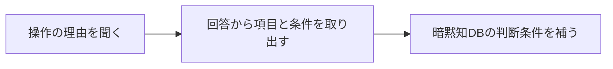
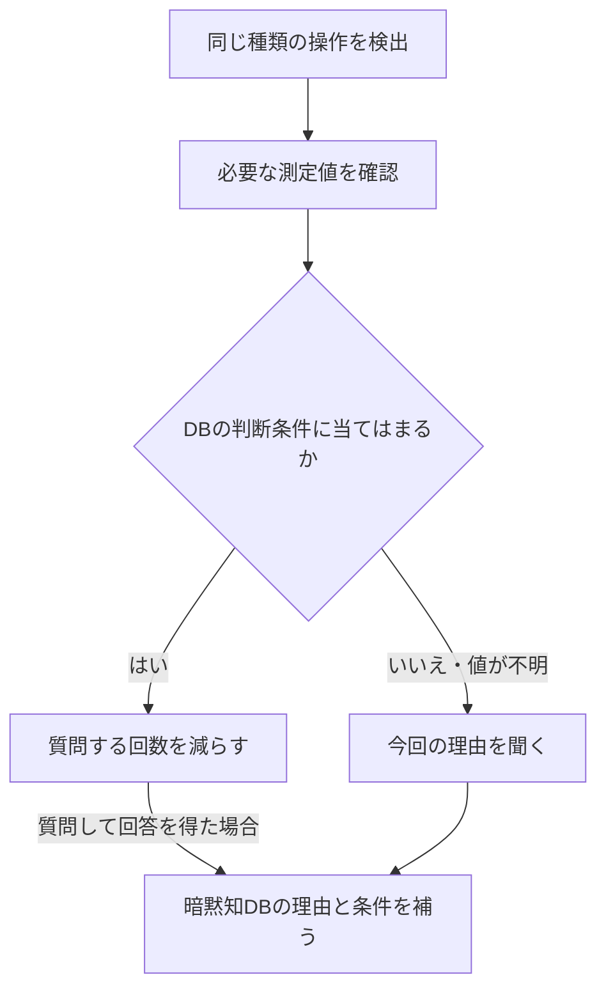

# 操作理由から判断条件を学び、次回の質問に反映する監視制御システム

出願検討資料｜2026年10月19日

## 1．背景

設備の監視システムには、測定値や操作履歴が残る。しかし、それだけでは「運転員が何を見て、なぜ操作したか」までは分からない。理由を毎回聞けば判断の知識を集められるが、同じ説明を繰り返す負担が生じる。

## 2．アイデア

**提案手法は、運転員に操作理由を聞き、回答から判断に使った項目と条件を得る。次回の操作では、その条件と今回の状態を比べて理由を聞くかを判断する。新しい回答を得たら、判断条件を補い、以後の質問判断に反映する。**

提案手法では、理由を聞いた結果によって、次回の質問の仕方を変える。既に理由を聞いた条件に当てはまる場合は質問を減らし、条件が異なる場合や情報が足りない場合は理由を聞く。回答から新しい判断材料を得たら、次回から確認する項目や条件も変える。

提案手法は、操作・理由・判断条件を暗黙知DBに保存する。操作履歴・監視データと関連付け、回答から得た条件を追加・補完する。アイデアの中心は、回答から得た条件を使って次回の質問判断を変え、新たな回答でさらに条件を更新する処理にある。暗黙知DBは、この処理を支える保存部品として使う。

### PAC増量での例

PACは、水中の汚れを集める凝集剤である。運転員がPACの注入量を増やしたとき、システムが理由を尋ねる。

| 場面 | 提案手法の動作 |
|---|---|
| 運転員がPACを増量する | 操作履歴から増量を検出し、暗黙知DBを確認する。理由が未登録なら「今回、PACを増やした理由は何ですか」と聞く。 |
| 運転員が「原水の濁りが強く、水温も低かったから」と回答する | 「PAC増量」という操作に、理由・確認項目・「濁度が高い、かつ水温が低い」という条件を関連付けてDBへ保存する。 |
| 後日、運転員が別の条件でPACを増量する | DBの条件だけでは今回の理由が分からないため、運転員に聞く。 |
| 回答から別の理由を得る | 新たな条件と理由をDBへ追加する。以前の条件と理由も残す。 |

「高い」「低い」の区分には施設の既存基準を使う。基準が分からない場合は確認し、システムが勝手に閾値を決めない。

<!-- pagebreak -->

## 3．暗黙知DBには何を保存するか

まず、どの設備で、何の設定を、どちらの方向に変えたかを操作履歴から確認する。例えば「A系列のPAC注入量を増やした操作」を、別系列の操作や減量操作と分けて扱う。

提案手法は、運転員の回答から、判断に使った監視項目とその条件を取り出し、操作・理由と結び付けて暗黙知DBに保存する。これにより、測定値の履歴だけでは把握できない「判断のつながり」を補う。

<!-- figure:acquisition -->

| 保存する情報 | 具体例 |
|---|---|
| どの操作か | A系列のPAC注入量を増やす操作 |
| 運転員の回答 | 「原水の濁りが強く、水温も低かったから」 |
| 判断に使った項目 | A系列の原水濁度、水温 |
| 回答から得た判断条件 | 施設の基準で、原水濁度が「高い」、かつ水温が「低い」 |

例えば、最初の回答が「濁りが強かったから」なら、まず濁度について保存する。その後の回答から「水温が低いことも判断に関係する」と確認したら、その説明がどの操作・条件に当てはまるかを確認して補う。別の理由で増量した事例は、別の条件として追加する。

回答の言葉は、実際の測定項目に対応付ける。例えば「原水の濁り」は、原水濁度の測定値に対応させる。項目名の辞書やLLMで候補を出し、施設にその測定項目があるかを確認する。

「濁度と水温を見た」としか分からない場合は、どんな状態だったかを追加で聞く。条件が決まるまでは、質問を減らす根拠に使わない。

新しい回答は、以前の回答を残したまま追加する。目視で確認した汚れの固まりなど、測定値に結び付けられない理由も保存するが、自動で質問を減らす判定には使わない。

<!-- pagebreak -->

## 4．学んだ条件を使い、次回の質問を判断する

提案手法は、同じ設備で同じ設定を同じ方向に変えた操作を検出すると、暗黙知DBから、その操作に関連する理由と条件を取り出す。操作時点の測定値と比べ、登録済みの条件に当てはまるかを確認する。未登録の状況や条件が不明な場合は理由を聞き、回答でDBを補う。

<!-- figure:runtime -->

提案手法は、濁度が高く水温が低い状態でのPAC再増量を検出したら、質問を減らす。水温が低くない場合や、水温の値を取得できない場合は理由を聞く。判断に関係のない別設備の測定値は比べない。

**条件が同じでも、理由が同じとは限らない。** そのため、条件に当てはまる場合も時々質問し、新しい理由を集める。質問をしなかった回には、過去の理由を今回の理由として記録しない。

新たな回答から「pHも見て判断した」と確認したら、次回からpHも確認する。濁度と水温だけが同じでも、pHの条件が違えば質問する。pHが分からない古い記録を、条件が一致した記録として扱わない。

<!-- pagebreak -->

## 5．近い特許と、今回比較する点

本案で比較するのは、**操作理由から判断項目と条件を得て、次回の操作時の状態と比べ、理由を聞く頻度を変え、新しい回答で条件を更新する一連の処理**である。暗黙知DBは、その情報を保存・参照するために使う。

以下は、これまで確認した「理由の取得と次回の質問制御」に関する比較である。理由の保存、条件の学習、質問の選択については既存技術があり、それらと本案の処理のつながりを具体的に比べる。

| 特許文献 | 確認した内容 | 本案との比較で残る点 |
|---|---|---|
| [JP2020173683A](https://patents.google.com/patent/JP2020173683A/ja) | 操作時にコメント入力を求め、操作と一緒に保存・表示する。判断基準や理由にも触れている。 | 理由から条件を作り、次回の質問を減らす処理は、確認箇所では見つかっていない。 |
| [JP2025026446A](https://patents.google.com/patent/JP2025026446A/ja) | 監視データへの専門家の回答を集め、根拠が足りなければ質問する。専門家が見た判断項目も取得する。 | 後の実操作で、回答から得た項目の状態を比べ、理由を聞く回数を減らす処理までは特定していない。 |
| [JP7726786B2](https://patents.google.com/patent/JP7726786B2/ja) | プラントについて質問し、回答から支援情報を作る。評価理由を使って質問を修正・追加・削除する記載もある。 | 操作理由から得た監視項目を使い、次回の操作で理由を聞く頻度を変える処理までは特定していない。 |
| [JP3057355B2](https://patents.google.com/patent/JP3057355B2/ja) | 状態や操作を標準事例と比べ、モデルで操作理由を説明できるかを判定する。 | 運転員の回答から条件を作り、次回の理由質問を減らす処理は、確認箇所では見つかっていない。 |

確認範囲：JP2020173683Aの請求項1〜4・実施形態4、JP2025026446Aの請求項1・8・10〜14と関連本文、JP7726786B2の登録請求項1・2・6と関連本文、JP3057355B2の登録請求項1・2・4・5・本文【0025】。

「見つかっていない」は、確認した範囲での結果を指す。公開公報の記載と、登録された請求項の範囲は区別して確認する。

<!-- pagebreak -->

## 6．関連する技術と、特許としての検討点

理由を学ぶ技術、対話で条件を作る技術、必要な質問を選ぶ技術には、既存の研究や特許がある。

| 関連文献 | 既に示されていること |
|---|---|
| [US20220237504A1](https://patents.google.com/patent/US20220237504A1/en)／[US12182671B2](https://patents.google.com/patent/US12182671B2/en) | 人が重視した特徴とモデルの説明を比べ、学習や質問対象の選択に使う。 |
| [Active Learning++](https://arxiv.org/html/2009.04568) | 人が重視した特徴の順位とモデルの説明の一致度から、次に質問する対象を選ぶ。 |
| [PUMICE](https://arxiv.org/html/1909.00031) | 対話や実演から条件・閾値・値の取得方法を学び、再利用する。 |
| [US5944839A](https://patents.google.com/patent/US5944839A/en) | 観測データで事例を評価し、足りない情報を機械や利用者から得る。 |
| [US6701195B2](https://patents.google.com/patent/US6701195B2/en) | 関係するセンサだけを使い、過去の似た事例を探して予測する。 |
| [US20090307162A1](https://patents.google.com/patent/US20090307162A1/en) | 操作の実演から学び、不足情報を質問する。質問による利益と回答の負担も考慮する。 |

### 現時点で分かっていること

確認した主要文献の中では、本案の一連の処理とすべて一致する単一文献は特定していない。ただし、関連文献を網羅した調査ではなく、新規性が確定したわけではない。

### さらに検討すること

既存の「理由の記録」「対話による条件学習」「質問対象の選択」を組み合わせれば、本案を作れるという指摘が考えられる。「理由を使って質問を改善する」という説明だけでは、違いが十分に伝わらない。

比較すべき点は、**回答から判断条件を得る処理、その条件で次回の状態を比べる処理、質問頻度を変える処理、新回答で条件を更新する処理のつながり**である。例えば、回答でpHが判断材料に加わったとき、次回からpHの違いも質問判断に反映する。このつながりを既存技術と比べる必要があり、特許性が確認済みという意味ではない。
