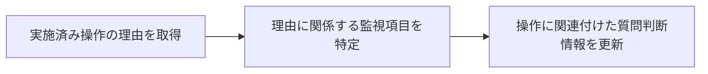
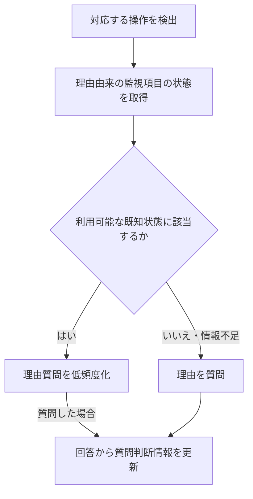

# 操作理由に基づいて質問判断を更新する監視制御システム

出願検討資料｜2026年10月15日

### 要旨

対話可能な監視制御システムにおいて、実施された操作の理由を運転員から取得する。その回答から判断に関係する監視項目を特定し、操作と関連付けて質問判断情報を保存する。後続の対応する操作では、当該監視項目の状態を参照して、理由を質問するかを判断する。新たな回答を得た場合には、以後の質問判断情報を更新する。

## 1．背景と課題

監視制御システムには、設備の状態と操作履歴が残る。一方、運転員が何を見て、なぜ操作したかは記録だけでは分からない。通常の操作に付随して理由を尋ねれば、ベテランの判断を説明として蓄積できる。しかし、毎回同じ理由を説明することは負担になる。

操作ごとの質問条件や監視項目をあらかじめ設定する方法では、設計者が現場の判断材料を先に把握する必要がある。監視状態全体の類似度で質問を減らす方法では、判断に無関係な項目の変化にも影響される。

## 2．提案の概要

**操作理由の回答から、判断に使われた監視項目と条件を特定する。次回の同じ操作では、その条件に当てはまるかを確認し、当てはまる場合は理由を尋ねる頻度を下げる。**

例えば、PAC増量の理由として「原水濁度が高く、水温も低かったため」と回答された場合、原水濁度と水温を監視項目とし、「高濁度、かつ低水温」を比較条件として保存する。次回のPAC増量でもこの条件を満たしていれば、理由の質問を減らす。条件を満たさない場合や監視値を取得できない場合は、今回の理由を尋ねる。状態の区分には施設の既存基準を用い、基準が不明な条件は確認できるまで質問を減らす根拠にしない。

発明の中心候補は、運転員の回答から比較すべき監視項目と条件を特定し、その条件を次回の理由質問の要否・頻度に使う構成である。新たな回答に別の判断材料が含まれていた場合は、比較項目や条件を更新する。質問を省略した回の理由は未確認として扱い、過去の理由を今回の事実として記録しない。

<!-- pagebreak -->

## 3．理由取得と質問判断情報の更新

操作イベントから設備、設定項目及び変更方向を特定し、必要に応じて「今回、PAC注入量を増やした理由は何ですか」と尋ねる。回答から、判断に使った監視項目を施設の監視タグへ対応付ける。回答に「高い」「低い」等の状態が含まれる場合は、利用可能な既存基準と対応付ける。

<!-- figure:acquisition -->

| 保存する情報 | PAC注入量増加の例 |
|---|---|
| 対応する操作 | 対象系列、PAC設定値、増加方向 |
| 原回答 | 「原水濁度が高く、水温も低かったため」 |
| 理由に関係する監視項目 | 対象系列の原水濁度・水温タグ |
| 質問判断に使う状態 | 既存基準による「高濁度」「低水温」の組合せ |

監視項目だけで質問要否は決まらない。状態の比較方法も必要である。本実施例では、施設の既存基準で区分した状態の組合せを使う。「高い」の対応先がない場合や、回答が「濁度と水温を見た」だけの場合は、閾値を推測して保存せず、短い補足質問等で確認できるまで省略判断には使わない。

新たな回答から参照項目又は状態条件が得られた場合、別の理由事例として追加する。以前の回答を上書きして失わない。目視したフロック等、監視値へ対応付けられない材料を含む理由は、未解決として保持する。自然言語処理の実装は、タグ別名辞書との照合やLLMによる候補抽出と、その対応先検査を組み合わせられる。

別の実施形態では、理由から参照項目だけを特定し、理由を取得した操作時点の状態区分を保存する。次回はその項目で保存状態と比較する。この方式は過去の理由取得済み状況の再出現を判断するもので、観測値から理由の因果条件や運転閾値を推定するものではない。

<!-- pagebreak -->

## 4．後続操作における対話制御

後続の操作が同じ設備・設定項目・変更方向に対応するとき、保存した質問判断情報を取得する。その情報が指定する監視項目について、当該操作時点の状態を参照する。既知の状態の組合せに該当する場合は質問を低頻度化し、異なる状態や情報不足の場合は今回の理由を尋ねる。

<!-- figure:runtime -->

例えば、以前の回答から「原水濁度が高い、かつ水温が低い」という状態が得られている場合、この組合せが再び生じたPAC増量では質問頻度を下げる。水温区分が変わった場合には理由を尋ねる。無関係な別設備の値の変化は、この判定に入れない。

質問頻度は、既知状態のときp既知、それ以外はpその他とし、0≦p既知＜pその他≦1とする。完全省略も選べるが、本実施例では既知状態でも質問を残す。新しい理由を取得する機会を維持するためであり、同じ状態なら必ず同じ理由だとみなすためではない。具体的な確率は運用上の取得漏れと負担から設定する。

新たな理由から比較項目を増やした場合、以前の少ない項目だけの一致で質問を減らし続けない。保存状態と比較する実施形態では、過去事例も追加後の項目で比較し直し、追加項目が不明な旧事例を一致扱いしない。時間条件や複雑な履歴参照は任意である。

<!-- pagebreak -->

## 5．発明の中心候補と主要公報

請求項1は、操作理由から参照項目集合と状態比較条件を特定し、後続操作の状態に応じて理由質問の出力確率を変更する構成とする。新たな回答を取得した場合は、参照項目集合又は比較条件を更新する。以下に、この構成と関連文献との対比を示す。

| 文献・確認箇所 | 確認した構成 | 今回の連結との残る差分 |
|---|---|---|
| [JP2020173683A](https://patents.google.com/patent/JP2020173683A/ja) 公開3→1又は2、4、本文実施形態4 | 操作時にコメント入力を求め、操作と関連保存・表示。本文では判断基準・理由にも言及。 | 理由を評価条件へ変換し、次回の質問制御へ使う処理は確認箇所で未確認。 |
| [JP2025026446A](https://patents.google.com/patent/JP2025026446A/ja) 公開1、8→1、10→1、11→10、12→11、13→10、14→1 | 監視データに基づく出力へのフィードバックを取得。根拠の十分性を判定し、不十分なら質問。知識蓄積・ユーザーモデル学習も開示。 | 本文は専門家が見た判断パラメータの取得まで含む。後続の実操作で項目の状態を比較して理由質問を低頻度化する連結は未特定。 |
| [JP7726786B2](https://patents.google.com/patent/JP7726786B2/ja) 登録1・2、6→4又は5 | プラントの質問、実グラフ及び模式図を提示し、回答から支援情報を生成。保存情報から判定フローを更新し質問を生成。 | 本文に評価理由による質問の修正・追加・削除もある。理由由来の監視集合で後続操作の理由取得頻度を変える連結は未特定。 |
| [JP3057355B2](https://patents.google.com/patent/JP3057355B2/ja) 登録1・2、4→2、5→4、本文0025 | 状態・操作を標準事例と比較。定性因果モデルで操作理由を説明できるか判定・分類。 | 対話回答から条件を生成して、次回の理由質問抑制へ使う処理は未確認。 |

従属項は親項の限定を含む。JP2025026446Aの請求項1にはローカル／リモート処理と動作前の出力提示等があり、理由質問一般を独占するものと解釈しない。公開公報の構成と登録権利範囲も区別する。「未確認」は確認した関連箇所での結果で、全文・全関連出願に不存在を保証する意味ではない。

<!-- pagebreak -->

## 6．関連技術と特許性の評価

| 技術の位置付け | 文献・確認範囲 | 公知例として確認した内容 |
|---|---|---|
| 理由を質問対象選択へ利用 | [US20220237504A1](https://patents.google.com/patent/US20220237504A1/en) 公開1〜6・本文、[US12182671B2](https://patents.google.com/patent/US12182671B2/en) 登録1・2 | 特徴の寄与・順位を分類器と比較し、重み付けや質問対象選択へ使う。産業設備の適用も本文にある。 |
| 理由由来の能動学習 | [Active Learning++](https://arxiv.org/html/2009.04568) 本文2節 | 注釈者の特徴順位と局所説明の一致度で、次の質問対象を選ぶ。 |
| 条件と取得元の対話定義 | [PUMICE](https://arxiv.org/html/1909.00031) 条件学習・一般化・誤り回復 | 条件、閾値及び値取得方法を対話・実演で定義・再利用。 |
| 既存データと不足質問 | [US5944839A](https://patents.google.com/patent/US5944839A/en) 登録1・2・5、FIG.2 | ケースを観測データで評価し、不足事実を機械又は利用者から取得。 |
| 選択したセンサで事例比較 | [US6701195B2](https://patents.google.com/patent/US6701195B2/en) 登録1〜4 | 関連センサだけの履歴類似度で事例検索・予測を行う。 |
| 質問の費用・利益を考慮 | [US20090307162A1](https://patents.google.com/patent/US20090307162A1/en) 公開1〜5・12〜19、質問選択本文 | 操作実演から学習し、不足を質問。知識獲得の利益と回答負担を考慮。 |

**新規性：** 請求項1を主要6組の文献の請求項及び関連本文と対比した。理由取得、回答由来の参照項目、後続操作の状態照合、質問低頻度化及び更新の連結全体に一致する単一文献は、この確認範囲では特定していない。分類・引用文献を含む網羅調査は未了である。

**進歩性：** 理由記録、対話的条件学習及び質問対象選択を組み合わせる指摘が想定される。能動学習にも理由を質問対象選択へ利用する例があるため、「理由で次の質問を改善する」だけでは差分を説明できない。本件では、理由から特定した監視項目による状態比較と、後続操作の理由取得頻度を変える処理との連結を検討対象とする。

請求項2は、項目追加後に過去事例も新しい項目で比較し直す構成とする。比較の整合を保つ通常の処理と評価される可能性があるため、この構成を加えるだけで進歩性が成立するとは判断できない。請求項1との連結を含めて検討する。

<!-- pagebreak -->

## 7．処理の検証と実測の区別

参照項目集合を更新する実施形態について、合成状態と確認済みの項目抽出結果を入力し、18例の質問判断を確認した。**自然言語解析や実施設の効果を検証した結果ではない。**

| 確認対象 | 結果 |
|---|---|
| 初回、対応操作の違い、関係する状態変化 | 質問対象として判定 |
| 同じ状態、無関係な別設備の変化 | 参照項目の一致により質問低頻度化 |
| 欠測、品質不適合、古い値 | 低頻度化を適用しない |
| 操作後の値 | 操作時点の比較に混ぜない |
| 新しい判断材料の追加 | 次回から追加後の項目集合で比較 |
| 旧事例に追加項目がない | 任意の状態に一致するものとして扱わない |
| 未観測の判断材料 | 保守的な例では低頻度化を保留 |
| 確率境界、既知状態での質問 | 指定した分岐と一致 |

重要な比較例は、濁度・水温が同じでpHだけが異なるケースである。pH追加前は既知状態として低頻度化した。新回答からpHを参照項目に追加した後は、旧事例にも新事例にも一致しないpH状態を質問対象とした。追加情報が実際の分岐へ反映されたことを、合成例で確認した。

時間条件を含む別の検証では、固定した二条件の評価を合成8例で確認した。参照項目集合の更新を扱う上記18例とは検証対象が異なる。

次の実測では、実際の匿名化理由回答を用い、項目抽出の正否、補足質問数、質問数及び新しい理由の取得漏れを比較する。質問数が減るだけでは知識取得の質が維持されたとは判断しない。性能実験を出願の一律の前提にはしないが、実施例と効果説明の根拠を補う。

<!-- pagebreak -->

## 8．特許として必要な要件の点検

**総合判断：発明として構成できる段階にあるが、登録要件を満たしたとは確認できていない。** 技術構成が成立すること、先行技術に対する特許性、出願書類の記載が十分であることを区別する。

| 要件 | 現時点の評価 | 本案で必要な確認・整備 |
|---|---|---|
| 発明該当性・産業上利用可能性 | 具体的な情報処理として説明可能 | 操作記録・監視履歴・条件記憶・プロセッサによる質問出力制御を一体で特定する。 |
| 新規性 | 重点文献で全体一致は未特定 | 請求項1の要素対比済み。分類・引用追跡と従属項の直接対比が必要。 |
| 進歩性 | 最大の未確認要件 | 理由記録・条件学習・不足質問を組み合わせる論理と、それに対する相違点を精査する。 |
| 実施可能要件 | 後段評価は具体例あり。前段仕様を第3節で具体化 | 理由回答から監視タグ及び質問判断用の状態条件を生成する手順を具体化。自然言語抽出の実測は未了。 |
| サポート要件 | 請求範囲の広げ方に注意 | 数値条件の例から、任意の理由・感覚情報を全自動処理する範囲へ無制限に一般化しない。 |
| 明確性・簡潔性 | 用語の整理が必要 | 同種操作の適用範囲、成立／評価不能、省略と低頻度化を定義する。 |

8例は固定条件の評価、18例は確認済み抽出結果を入力した集合更新と質問判断の確認である。いずれも、自由文から正しく項目を抽出する処理の実測ではない。「同種操作」は設備・設定項目・変更方向等によって特定する。確率方式では、条件成立時の質問率を不成立時より低く設定する。

記載の具体化と進歩性は別である。明細書を詳しくすれば既存技術との差が自動的に生まれるわけではなく、実測や予想外の効果が一律に登録の必要条件になるわけでもない。発明者・出願人・公開履歴・先願関係は別途確認が必要である。

判断基準：特許庁の[発明該当性](https://www.jpo.go.jp/system/laws/rule/guideline/patent/tukujitu_kijun/ht/03_0100.html)、[新規性・進歩性](https://www.jpo.go.jp/system/laws/rule/guideline/patent/tukujitu_kijun/ht/03_0200.html)、[請求項の記載要件](https://www.jpo.go.jp/system/laws/rule/guideline/patent/tukujitu_kijun/ht/02_0200.html)に基づく初期評価。

<!-- pagebreak -->

## 9．請求項構成と出願時の確認事項

請求項1では、理由の取得、監視項目・比較条件の特定、後続操作の状態照合及び質問出力制御を規定する。時間条件や知識グラフは任意の実施形態とする。

### 主項と従属項の構成

主項は、実操作理由から参照項目集合と状態比較条件を形成し、後続操作でその項目の状態を比較して、条件成立時の理由質問確率を下げ、新回答で集合又は条件を更新する構成とする。

従属項2は、項目追加後に旧事例も更新後の項目で比較し直し、追加項目が不明な旧事例を一致扱いしない構成である。従属項3は既知状態でも質問を残す構成、4は評価不能時の質問、5は操作キーと参照時刻の特定である。各従属項は1のみを引用する。

### その他の関連文献

| 文献・確認範囲 | 既存構成として区別するもの |
|---|---|
| 理由の知識化：[US20210056508A1](https://patents.google.com/patent/US20210056508A1/en) 公開1〜5・本文、[ASK](https://tomgruber.org/writing/automated-knowledge-acquisition-for-strategic-knowledge/) 著者要旨 | 前者は工程の不足情報・重要判断の理由取得。後者は行為理由から戦略知識を獲得する。ASK全文は未精査。 |
| 規則の生成・確認：[US20200125659A1](https://patents.google.com/patent/US20200125659A1/en) 公開1・3・7・8・10・11、[EP4124989A1](https://patents.google.com/patent/EP4124989A1/en) 公開1〜9 | 前者は構造化した規則の履歴検証。後者は解釈差の確認と有効化。 |
| 自然言語から監視：[US8769346B2](https://patents.google.com/patent/US8769346B2/en) 登録1・6〜8 | 規則化したポリシーによる監視・自己修復。 |
| 不足質問・取得頻度：[US9805718B2](https://patents.google.com/patent/US9805718B2/en) 登録1、[NIPS 2010](https://arxiv.org/html/1006.2588) 本文2.2・Algorithm 1 | 前者は型に応じた不足情報の質問。後者は履歴と入力に基づく確率的な教示取得。 |
| [US11907863B2](https://patents.google.com/patent/US11907863B2/en) 登録1〜10 | 対話の知識ギャップの検出・質問・知識更新 |
| [US7225176B2](https://patents.google.com/patent/US7225176B2/en) 登録1〜8 | 関連属性の観測コストを考慮したケース質問 |
| [RDR原著](https://ksi.cpsc.ucalgary.ca/KAW/KAW98/martinez1/) 本文1・2・2.1 | 事例差分から条件・例外を追加する知識更新。条件追加だけを独自点にしない。 |

出願前に、発明者と各人の創作寄与、出願人、社外公開の有無・時期及び社内関連出願を確認する。特許性については、前記の先行技術対比に加え、分類・引用文献による追加調査を要する。
